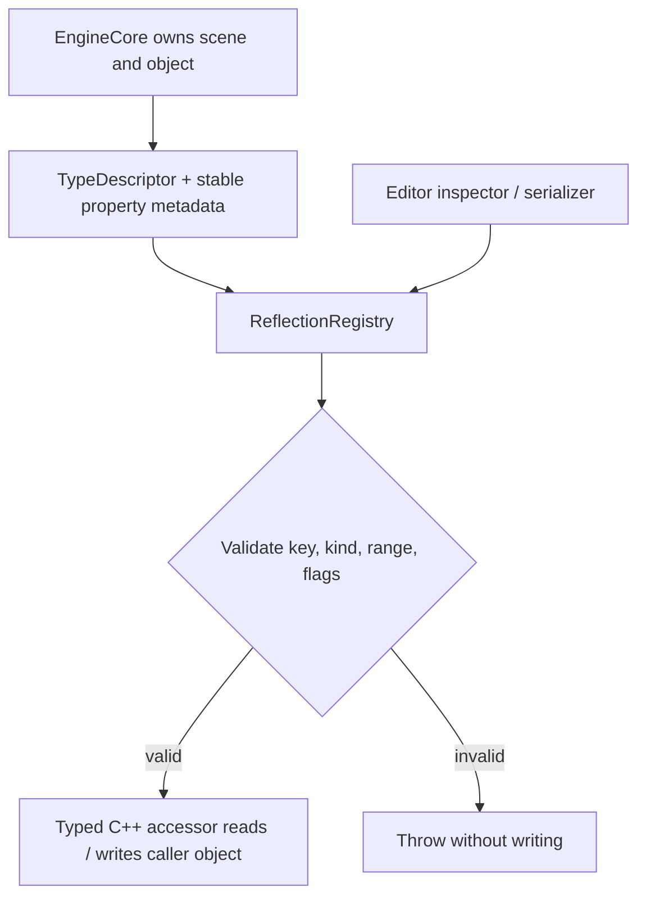

# Reflection as a checked bridge between runtime objects and authoring tools

Study this together with the [source-reading order](SOURCE_READING_ORDER.md). KairoReflection does not discover arbitrary C++ members automatically, own a scene or draw an inspector. It makes explicitly registered properties inspectable through a stable, validated value API.

## 1. What reflection solves

C++ does not automatically expose portable runtime field metadata for arbitrary game-engine objects. An editor may need to show a camera's field of view or a mesh reference, while a serializer must use the same field identity across binaries and compiler versions. C++ RTTI type names do not provide that persistent contract.

KairoReflection associates **stable dotted ASCII type/property keys** with human-readable metadata and accessor functions. [ReflectionTypes.cppm](../ReflectionTypes.cppm) defines the value/schema language; [ReflectionRegistry.cppm](../ReflectionRegistry.cppm) registers concrete types and dispatches reads/writes.

KairoECS owns component storage, KairoEngineCore owns authored objects, and KairoEditor owns presentation/command transactions. The reflection registry owns **descriptors**, not the object pointers it receives. Passing a pointer of the wrong C++ type through `void*` is outside its safety guarantee and is the caller's responsibility.

## 2. Stable keys versus display labels

`IsStableKey` validates a dotted ASCII identifier such as `Kairo.Engine.CameraSettings`. The constraints prevent ambiguous empty segments or arbitrary control/unicode bytes from appearing in persistent identity; display names and tooltips remain distinct, user-facing fields. Registered types are immutable and their properties are sorted by stable key so plugin registration order does not silently reorder serialized or inspector state.

A `PropertyDescriptor` carries metadata, a declared `PropertyValueKind`, and `std::function` read/write accessors. `std::function` stores a callable wrapper; it does not allocate an instance of the reflected C++ type.

## 3. Value transport and variants

`PropertyValue` uses an owning `std::variant` of booleans, signed/unsigned integers, doubles, strings, small math vectors/quaternions, enum choices, references, and bounded homogeneous arrays. `Kind()` identifies the currently active alternative; `Get<T>()` performs type-checked access via `std::get`.

Composite math values intentionally transport double components instead of exposing an unrelated runtime's vector type or ABI. The owner of `Vec3f` or `Quatf` provides an explicit conversion; the registry itself stays independent from KairoMath's concrete storage representation. It validates finite numbers and rejects nested arrays under its current V3 contract.

## 4. Where validation occurs

Registration checks the type ID, metadata limits, unique keys, enum options, and property-specific flags. `ReflectionRegistry::Read` first requires a nonnull caller-owned object, resolves a type/field descriptor, runs the accessor and validates the returned value. `Write` requires a nonnull object, rejects read-only fields, checks the exact expected kind and validates the candidate before invoking its setter.

This ordering is critical: an inspector should not partially overwrite an object when a user enters `180` for a field-of-view property with a maximum of `179`, or supplies a `string` to a floating-point field. A successful precondition check does not protect against **arbitrary exception-throwing user-provided custom setter code**, however; stronger transactional semantics must come from the caller's authoring command system.

## 5. How typed member pointers bridge C++

`MakeMemberProperty<Object>(metadata, &Object::Field)` captures a member pointer and constructs read/write lambdas. The compiler checks the member type when the descriptor is created, but at runtime the registry's opaque object pointer must actually point to a live `Object`.

For composite types, `MakeAdaptedMemberProperty` uses explicit encoders/decoders. `MakeEnumMemberProperty` translates a C++ enum into a stable option key and integer representation; both pieces must match registered choices. Reference adapters encode a *target type and identifier*, not an owned asset pointer. They do not check that the referenced asset still exists. Primitive array adapters first decode into a temporary vector so a failed conversion cannot partially replace a member.

## 6. Follow one inspector edit

A camera settings struct is registered under `Kairo.Engine.CameraSettings` with a `field-of-view` property. An Editor UI creates a `PropertyValue(75.0)`, then invokes `registry.Write(typeKey, propertyKey, &camera, value)`. The registry validates kind, range and read-only status and only then calls the typed member setter. A separate Editor command or document transaction is needed to support undo/redo and persistence.

That separation is what keeps the reflection API usable in native tools, non-graphical tests and scene serialization without giving the registry a graphics API or a transaction database.

## 7. What the tests establish

[ReflectionTests.cpp](../tests/ReflectionTests.cpp) has six Catch2 scenarios covering primitive access, invalid writes, stable metadata, V2 composite/enum/reference round trips, invalid contracts and V3 bounded arrays. [CMakeLists.txt](../CMakeLists.txt) assembles three C++23 modules and optional Catch2 test target.

A source file containing six tests does not mean they were run on the teaching branch. No new compilation or native test acceptance was completed as part of these documentation commits.

## 8. Exercises

Register a custom `MaterialSettings` struct with roughness, color and texture-reference properties. Make roughness range [0,1] and mark a revision counter read-only. Read the values, then deliberately try a mismatched type, a NaN and an out-of-range number. Check that the original object remains unchanged in all invalid cases. Finally, write a custom decoder that throws during assignment and explain why transactional command handling may be needed beyond metadata validation.
